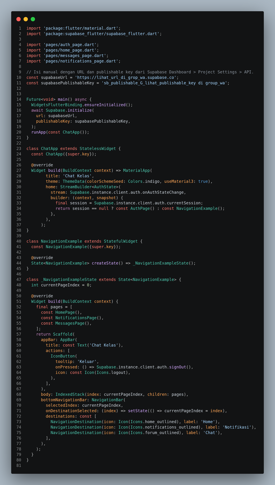
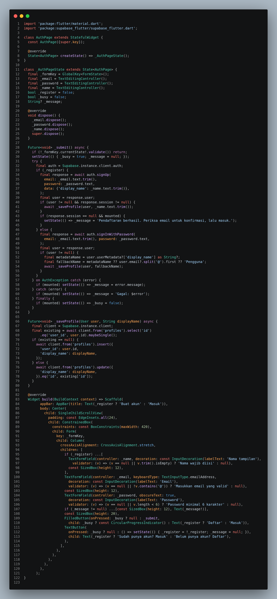
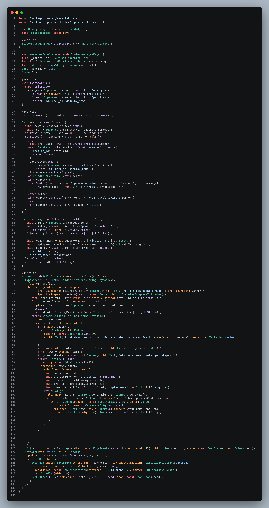
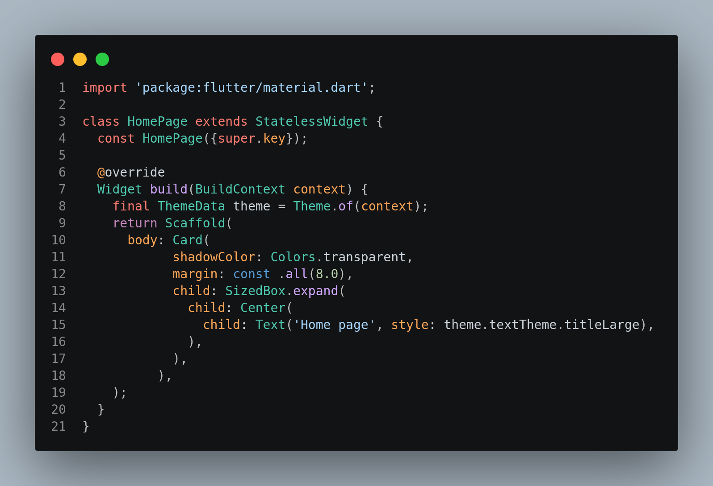

# Praktik Lanjutan: Integrasi Chat Grup Flutter + Supabase

**Untuk:** Mahasiswa SI Angkatan 2025, Kelas A, Prodi SI Polnustar  
**Target:** Membuat registrasi, login, satu room chat grup realtime, dan notifikasi pesan.

Memodifikasi Project yang telah kita buat pekan lalu

##Ikuti urutan langkah. Setiap langkah menambahkan satu bagian kecil kode ke file yang disebutkan. Jangan menyalin seluruh aplikasi sekaligus.##

## Setup Supabase project

Setup Supabase Sudah Dilakukan Pekan Lalu

## 1. Tambahkan package

Di terminal vs code project jalankan:

```bash
flutter pub add supabase_flutter
```

Package ini menyediakan Auth, query database, dan realtime.

## 2. Hubungkan Supabase di `lib/main.dart`

### 2.1 Tambah import

Di bagian atas file, pertahankan import yang sudah ada dan tambahkan import yang belum tersedia. Pada project ini, tambahkan:

```dart
import 'package:supabase_flutter/supabase_flutter.dart';
import 'pages/auth_page.dart';
import 'pages/messages_page.dart';
```

Import `home_page.dart` dan `notifications_page.dart` yang sudah ada tetap dipakai.

### 2.2 Tambahkan konfigurasi manual

Di luar class, sebelum `main()`, sisipkan konstanta ini. Ganti contoh dengan URL dan publishable key project Anda dari **Project Settings > API**:

**UNTUK SAAT INI GUNAKAN supabaseURL dan supabasePublishableKey yang akan dikirim di group**

```dart
const supabaseUrl = 'https://lihat_url_di_grop_wa.supabase.co';
const supabasePublishableKey = 'sb_publishable_G_lihat_publishable_key di group_wa';
```

### 2.3 Inisialisasi sebelum aplikasi berjalan

Ganti fungsi `main()` lama dengan:

```dart
Future<void> main() async {
  WidgetsFlutterBinding.ensureInitialized();
  await Supabase.initialize(
    url: supabaseUrl,
    publishableKey: supabasePublishableKey,
  );
  runApp(const ChatApp());
}
```

`Supabase.initialize()` menyiapkan client yang akan digunakan semua halaman.

## 3. Buat halaman registrasi/login

Buat `lib/pages/auth_page.dart`. Tambahkan setiap bagian berikut di dalam file tersebut secara berurutan.

### 3.1 Kerangka widget dan controller

Mulai file dengan import, class, dan state berikut:

```dart
import 'package:flutter/material.dart';
import 'package:supabase_flutter/supabase_flutter.dart';

class AuthPage extends StatefulWidget {
  const AuthPage({super.key});
  @override
  State<AuthPage> createState() => _AuthPageState();
}

class _AuthPageState extends State<AuthPage> {
  final _formKey = GlobalKey<FormState>();
  final _email = TextEditingController();
  final _password = TextEditingController();
  final _name = TextEditingController();
  bool _register = false;
  bool _busy = false;
  String? _message;

  @override
  void dispose() {
    _email.dispose();
    _password.dispose();
    _name.dispose();
    super.dispose();
  }
```

Controller mengambil isi input. `_register` memilih mode daftar atau masuk.

### 3.2 Tambahkan fungsi menyimpan profil

Di dalam `_AuthPageState`, setelah `dispose()`, tambahkan:

```dart
  Future<void> _saveProfile(User user, String displayName) async {
    final client = Supabase.instance.client;
    final existing = await client.from('profiles').select('id')
        .eq('user_id', user.id).maybeSingle();
    if (existing == null) {
      await client.from('profiles').insert({
        'user_id': user.id,
        'display_name': displayName,
      });
    } else {
      await client.from('profiles').update({
        'display_name': displayName,
      }).eq('id', existing['id']);
    }
  }
```

`auth.users.id` disimpan pada `profiles.user_id`. Tabel `profiles` membuat `id` profilnya sendiri; ID ini dipakai sebagai pengirim pesan.

### 3.3 Tambahkan proses daftar dan masuk

Masih di class yang sama, setelah `_saveProfile()`, sisipkan:

```dart
  Future<void> _submit() async {
    if (!_formKey.currentState!.validate()) return;
    setState(() { _busy = true; _message = null; });
    try {
      final auth = Supabase.instance.client.auth;
      if (_register) {
        final result = await auth.signUp(
          email: _email.text.trim(),
          password: _password.text,
          data: {'display_name': _name.text.trim()},
        );
        if (result.user != null && result.session != null) {
          await _saveProfile(result.user!, _name.text.trim());
        }
        if (result.session == null && mounted) {
          setState(() => _message = 'Periksa email untuk konfirmasi, lalu masuk.');
        }
      } else {
        final result = await auth.signInWithPassword(
          email: _email.text.trim(), password: _password.text,
        );
        final user = result.user;
        if (user != null) {
          final name = user.userMetadata?['display_name'] as String?
              ?? user.email?.split('@').first ?? 'Pengguna';
          await _saveProfile(user, name);
        }
      }
    } on AuthException catch (error) {
      if (mounted) setState(() => _message = error.message);
    } catch (error) {
      if (mounted) setState(() => _message = 'Gagal: $error');
    } finally {
      if (mounted) setState(() => _busy = false);
    }
  }
```

`signUp()` mendaftarkan akun. `signInWithPassword()` memeriksa kredensial. Keduanya memastikan baris profil tersedia.

### 3.4 Tambahkan form

Setelah `_submit()`, tambahkan `build()` ini. Setelah itu tutup class dengan `}`:

```dart
  @override
  Widget build(BuildContext context) => Scaffold(
    appBar: AppBar(title: Text(_register ? 'Buat akun' : 'Masuk')),
    body: Center(child: SingleChildScrollView(
      padding: const EdgeInsets.all(24),
      child: Form(key: _formKey, child: Column(
        crossAxisAlignment: CrossAxisAlignment.stretch,
        children: [
          if (_register) TextFormField(
            controller: _name,
            decoration: const InputDecoration(labelText: 'Nama tampilan'),
            validator: (v) => v == null || v.trim().isEmpty ? 'Nama wajib diisi' : null,
          ),
          TextFormField(
            controller: _email,
            decoration: const InputDecoration(labelText: 'Email'),
            validator: (v) => v == null || !v.contains('@') ? 'Email tidak valid' : null,
          ),
          TextFormField(
            controller: _password,
            obscureText: true,
            decoration: const InputDecoration(labelText: 'Password'),
            validator: (v) => v == null || v.length < 6 ? 'Minimal 6 karakter' : null,
          ),
          if (_message != null) Text(_message!),
          FilledButton(
            onPressed: _busy ? null : _submit,
            child: Text(_register ? 'Daftar' : 'Masuk'),
          ),
          TextButton(
            onPressed: () => setState(() => _register = !_register),
            child: Text(_register ? 'Sudah punya akun? Masuk' : 'Belum punya akun? Daftar'),
          ),
        ],
      )),
    )),
  );
```

## 4. Tambahkan gerbang sesi dan navigasi di `main.dart`

Setelah fungsi `main()`, tambahkan class `ChatApp`. Auth stream mengganti halaman
login dengan navigasi setelah pengguna masuk. Hapus class `NavigationBarApp` lama
karena aplikasi sekarang dimulai melalui `ChatApp`:

```dart
class ChatApp extends StatelessWidget {
  const ChatApp({super.key});
  @override
  Widget build(BuildContext context) => MaterialApp(
    title: 'Chat Kelas',
    home: StreamBuilder<AuthState>(
      stream: Supabase.instance.client.auth.onAuthStateChange,
      builder: (context, snapshot) =>
          Supabase.instance.client.auth.currentSession == null
              ? const AuthPage() : const NavigationExample(),
    ),
  );
}
```

Cari class `NavigationExample` lama dan ganti seluruh class tersebut dengan kode di
bawah. `HomePage` adalah halaman lama project:

```dart
class NavigationExample extends StatefulWidget {
  const NavigationExample({super.key});
  @override
  State<NavigationExample> createState() => _NavigationExampleState();
}

class _NavigationExampleState extends State<NavigationExample> {
  int currentPageIndex = 0;
  @override
  Widget build(BuildContext context) {
    final pages = [const HomePage(), const NotificationsPage(), const MessagesPage()];
    return Scaffold(
      appBar: AppBar(title: const Text('Chat Kelas'), actions: [
        IconButton(
          onPressed: () => Supabase.instance.client.auth.signOut(),
          icon: const Icon(Icons.logout),
        ),
      ]),
      body: IndexedStack(index: currentPageIndex, children: pages),
      bottomNavigationBar: NavigationBar(
        selectedIndex: currentPageIndex,
        onDestinationSelected: (i) => setState(() => currentPageIndex = i),
        destinations: const [
          NavigationDestination(icon: Icon(Icons.home_outlined), label: 'Home'),
          NavigationDestination(icon: Icon(Icons.notifications_outlined), label: 'Notifikasi'),
          NavigationDestination(icon: Icon(Icons.forum_outlined), label: 'Chat'),
        ],
      ),
    );
  }
}
```

## 5. Buat chat realtime

Buat `lib/pages/messages_page.dart`, lalu tambahkan bagian-bagiannya sesuai urutan.

### 5.1 State, stream pesan, dan daftar profil

```dart
import 'package:flutter/material.dart';
import 'package:supabase_flutter/supabase_flutter.dart';

class MessagesPage extends StatefulWidget {
  const MessagesPage({super.key});
  @override
  State<MessagesPage> createState() => _MessagesPageState();
}

class _MessagesPageState extends State<MessagesPage> {
  final _controller = TextEditingController();
  late final Stream<List<Map<String, dynamic>>> _messages;
  late Future<List<Map<String, dynamic>>> _profiles;
  bool _sending = false;
  String? _error;

  @override
  void initState() {
    super.initState();
    _messages = Supabase.instance.client.from('messages')
        .stream(primaryKey: ['id']).order('created_at');
    _profiles = Supabase.instance.client.from('profiles')
        .select('id, user_id, display_name');
  }
```

Stream memantau `messages`; query profil dipakai untuk mencari nama pengirim.

### 5.2 Tambahkan fungsi profil dan kirim

Setelah `initState()`, tambahkan fungsi berikut:

```dart
  Future<String> _getOrCreateProfileId(User user) async {
    final client = Supabase.instance.client;
    final row = await client.from('profiles').select('id')
        .eq('user_id', user.id).maybeSingle();
    if (row != null) return row['id'].toString();
    final name = user.userMetadata?['display_name'] as String?
        ?? user.email?.split('@').first ?? 'Pengguna';
    final created = await client.from('profiles').insert({
      'user_id': user.id, 'display_name': name,
    }).select('id').single();
    return created['id'].toString();
  }

  Future<void> _send() async {
    final text = _controller.text.trim();
    final user = Supabase.instance.client.auth.currentUser;
    if (text.isEmpty || user == null || _sending) return;
    setState(() { _sending = true; _error = null; });
    try {
      final profileId = await _getOrCreateProfileId(user);
      await Supabase.instance.client.from('messages').insert({
        'profile_id': profileId, 'content': text,
      });
      _controller.clear();
      _profiles = Supabase.instance.client.from('profiles')
          .select('id, user_id, display_name');
      if (mounted) setState(() {});
    } on PostgrestException catch (error) {
      if (mounted) setState(() => _error = error.message);
    } catch (error) {
      if (mounted) setState(() => _error = 'Pesan gagal dikirim: $error');
    } finally {
      if (mounted) setState(() => _sending = false);
    }
  }
```

`profile_id` mengambil UUID dari `profiles.id`, bukan `auth.users.id`. `content` menyimpan teks chat.

### 5.3 Tambahkan tampilan stream dan kotak pesan

Setelah `_send()`, tambahkan `build()` berikut, lalu tutup class dengan `}`:

```dart
  @override
  Widget build(BuildContext context) => Column(children: [
    Expanded(child: FutureBuilder<List<Map<String, dynamic>>>(
      future: _profiles,
      builder: (context, ps) {
        if (!ps.hasData) return const Center(child: CircularProgressIndicator());
        final profiles = {for (final p in ps.data!) p['id'].toString(): p};
        final mine = ps.data!.where((p) =>
            p['user_id'] == Supabase.instance.client.auth.currentUser?.id).toList();
        final myId = mine.isEmpty ? null : mine.first['id'].toString();
        return StreamBuilder<List<Map<String, dynamic>>>(
          stream: _messages,
          builder: (context, snapshot) {
            if (!snapshot.hasData) return const Center(child: CircularProgressIndicator());
            final rows = snapshot.data!;
            return ListView.builder(
              reverse: true,
              itemCount: rows.length,
              itemBuilder: (context, i) {
                final row = rows[rows.length - 1 - i];
                final id = row['profile_id']?.toString();
                final isMine = id == myId;
                final sender = profiles[id]?['display_name'] as String? ?? 'Anggota';
                return ListTile(
                  title: Text(isMine ? 'Anda' : sender),
                  subtitle: Text(row['content'] as String? ?? ''),
                  trailing: isMine ? const Icon(Icons.check) : null,
                );
              },
            );
          },
        );
      },
    )),
    if (_error != null) Text(_error!, style: const TextStyle(color: Colors.red)),
    SafeArea(child: Row(children: [
      Expanded(child: TextField(controller: _controller,
          decoration: const InputDecoration(hintText: 'Tulis pesan...'))),
      IconButton(onPressed: _sending ? null : _send, icon: const Icon(Icons.send)),
    ])),
  ]);
```

`StreamBuilder` membangun ulang daftar saat ada pesan baru. `FutureBuilder` memasangkan `profile_id` ke nama profil.

## 6. Buat daftar notifikasi

Buat `lib/pages/notifications_page.dart`. Tambahkan import, widget, dan stream:

```dart
import 'package:flutter/material.dart';
import 'package:supabase_flutter/supabase_flutter.dart';

class NotificationsPage extends StatefulWidget {
  const NotificationsPage({super.key});
  @override
  State<NotificationsPage> createState() => _NotificationsPageState();
}

class _NotificationsPageState extends State<NotificationsPage> {
  late final Stream<List<Map<String, dynamic>>> _messages;
  late final Future<List<Map<String, dynamic>>> _profiles;
  @override
  void initState() {
    super.initState();
    _messages = Supabase.instance.client.from('messages')
        .stream(primaryKey: ['id']).order('created_at', ascending: false);
    _profiles = Supabase.instance.client.from('profiles')
        .select('id, user_id, display_name');
  }
```

Setelah `initState()`, sisipkan `build()` berikut dan tutup class dengan `}`:

```dart
  @override
  Widget build(BuildContext context) => StreamBuilder<List<Map<String, dynamic>>>(
    stream: _messages,
    builder: (context, snapshot) {
      if (!snapshot.hasData) return const Center(child: CircularProgressIndicator());
      return FutureBuilder<List<Map<String, dynamic>>>(
        future: _profiles,
        builder: (context, ps) {
          if (!ps.hasData) return const Center(child: CircularProgressIndicator());
          final profiles = {for (final p in ps.data!) p['id'].toString(): p};
          final mine = ps.data!.where((p) =>
              p['user_id'] == Supabase.instance.client.auth.currentUser?.id).toList();
          final myId = mine.isEmpty ? null : mine.first['id'].toString();
          final incoming = snapshot.data!
              .where((m) => m['profile_id']?.toString() != myId).toList();
          return ListView.builder(
            itemCount: incoming.length,
            itemBuilder: (context, i) {
              final message = incoming[i];
              final profile = profiles[message['profile_id']?.toString()];
              final name = profile == null
                  ? 'Anggota grup'
                  : (profile['display_name'] as String? ?? 'Anggota grup');
              return ListTile(
                leading: const Icon(Icons.notifications_outlined),
                title: Text('Pesan baru dari $name'),
                subtitle: Text(message['content'] as String? ?? ''),
              );
            },
          );
        },
      );
    },
  );
```

Notifikasi ini tampil di dalam aplikasi. Push notification saat aplikasi ditutup merupakan materi lanjutan.

## 7. Jalankan dan uji bertahap

Setelah menyelesaikan tiap file, simpan perubahan dan jalankan:

```bash
flutter analyze
```

Jika tidak ada error, jalankan aplikasi:

```bash
flutter run
```

Uji dengan dua akun/perangkat: daftar (register) dan masuk (login), buka menu cmhat, kemudian kirim pesan , lalu pastikan teman lain menerima pesan realtime dan melihat notifikasi.

Jika terjadi error, baca pesan error lengkap, periksa nama tabel/kolom, dan pastikan akun dapat membaca atau menulis data yang digunakan aplikasi.

## File yang dikerjakan

- `pubspec.yaml` diperbarui lewat `flutter pub add`.
- `lib/main.dart` ditambah inisialisasi, auth gate, dan navigasi.
- `lib/pages/auth_page.dart` dibuat baru secara bertahap.
- `lib/pages/messages_page.dart` dibuat bertahap.
- `lib/pages/notifications_page.dart` dibuat bertahap.
- `lib/pages/home_page.dart` tetap menggunakan halaman yang sudah ada.

## DAFTAR KODE LENGKAP 

### lib/main.dart



### lib/pages/auth_page.dart


### lib/pages/messages_page.dart


### lib/pages/notifications_page.dart


### lib/pages/home_page.dart

